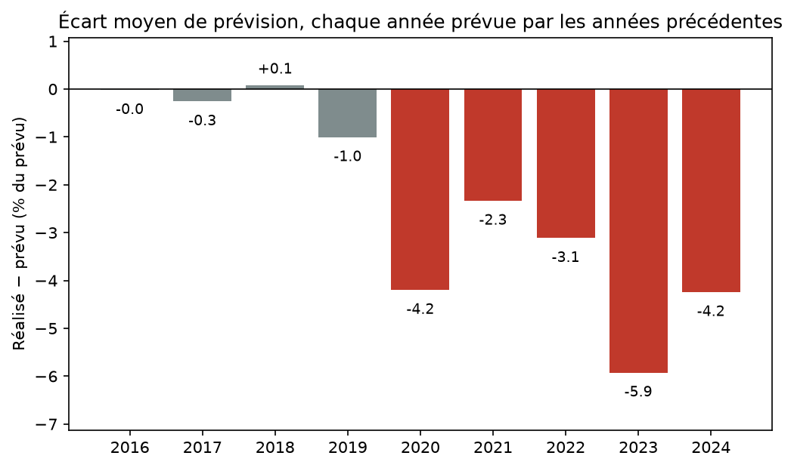
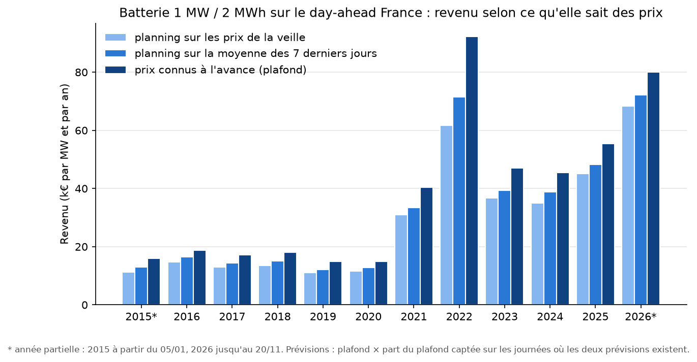

# Électricité en France : consommation, température et arbitrage d'une batterie sur le day-ahead

> **In English.** *Demand:* a temperature and calendar model (R² 0.93 on 2013-2021), re-fitted each year on the
> previous years only, keeps its yearly mean error between −1.0% and +0.1% from 2016 to 2019; from 2022 to 2024,
> consumption runs 3 to 6% below its forecast. *Battery:* 1 MW / 2 MWh on the French day-ahead market, 2015-2026:
> planning on the previous seven days' average prices captures 84% of the perfect-foresight revenue, planning on the
> previous day's prices 77%. Since the market moved to 15-minute prices (1 October 2025), choosing quarter-hours
> rather than one power level per hour adds 7.7% with known prices, 3.1% when planning on the previous day's prices.
> Code written by an AI coding agent (Claude Code) under the author's direction.

Deux questions, traitées sur données publiques :

1. **Un modèle simple de la consommation française tient-il hors échantillon, et quand se trompe-t-il ?**
2. **Combien aurait rapporté une batterie en arbitrage sur le prix spot (day-ahead), et quelle part de ce revenu
   tient à la connaissance des prix à l'avance ?**

## Résultats

### Consommation et température (2013-2024)

Régression linéaire de la consommation journalière sur les degrés-jours de chauffage (sous 15 °C) et de
climatisation (au-dessus de 22 °C), le jour de la semaine, les jours fériés, le mois d'août et la fin d'année.

- Estimé sur 2013-2021 : **R² 0,93**, et **2,34 GW de consommation en plus par degré de froid** sous 15 °C. C'est
  le même ordre de grandeur que les 2 400 MW par degré que RTE cite pour le cœur de l'hiver
  ([source](https://www.connaissancedesenergies.org/reseau-electrique-le-nucleaire-au-coeur-des-reflexions-241104)),
  qui portent sur la puissance appelée et non sur une moyenne journalière.
- Chaque année prévue par un modèle estimé sur les années précédentes (walk-forward) :

| année prévue | 2016 | 2017 | 2018 | 2019 | 2020 | 2021 | 2022 | 2023 | 2024 |
|---|---|---|---|---|---|---|---|---|---|
| écart moyen réalisé − prévu | 0,0 % | −0,3 % | +0,1 % | −1,0 % | −4,2 % | −2,3 % | −3,1 % | −5,9 % | −4,2 % |
| erreur absolue moyenne | 3,5 % | 3,6 % | 3,4 % | 3,6 % | 6,6 % | 4,6 % | 4,4 % | 6,4 % | 5,2 % |

  Avant 2020, l'écart moyen reste entre −1,0 % et +0,1 %. Le modèle surestime la consommation en 2020 et 2021
  (confinements, couvre-feux), puis durablement depuis 2022 : la baisse de consommation qui suit la crise de 2022
  n'est pas dans les années d'apprentissage, et elle persiste même quand 2022 et 2023 y entrent.
- Le seuil de 15 °C n'est pas posé à la main : parmi les seuils entiers de 12 à 18 °C, c'est celui qui ajuste le
  mieux l'apprentissage (R² 0,9316, contre 0,9249 à 14 °C et 0,9308 à 16 °C).



### Batterie en arbitrage sur le day-ahead France (5 janvier 2015 – 20 novembre 2026)

Batterie de 1 MW pour 2 MWh, rendement aller-retour 88 %, au plus un cycle par jour. Chaque journée est un
programme linéaire : quand charger, quand décharger, sous les contraintes de puissance, de capacité, de rendement et
de cycle. Trois stratégies, toutes payées aux prix réalisés : planning calculé sur les prix réalisés eux-mêmes
(plafond), sur la moyenne des sept derniers jours, ou sur les prix de la veille.

| année | 2015* | 2016 | 2017 | 2018 | 2019 | 2020 | 2021 | 2022 | 2023 | 2024 | 2025 | 2026* |
|---|---|---|---|---|---|---|---|---|---|---|---|---|
| revenu avec les prix connus à l'avance (k€ par MW) | 16,0 | 18,7 | 17,1 | 18,1 | 14,9 | 15,0 | 40,3 | 92,2 | 47,1 | 45,4 | 55,3 | 80,0 |
| part captée, moyenne des sept derniers jours | 81 % | 88 % | 84 % | 84 % | 82 % | 86 % | 83 % | 78 % | 84 % | 86 % | 87 % | 90 % |
| part captée, prix de la veille | 70 % | 78 % | 76 % | 74 % | 74 % | 77 % | 77 % | 67 % | 78 % | 77 % | 82 % | 85 % |

\* 2015 : à partir du 5 janvier (361 jours) ; 2026 : jusqu'au 20 novembre (324 jours). Les deux prévisions sont
comparées sur les mêmes 4 280 journées, sur 4 338 : sont écartés les jours de changement d'heure, leurs lendemains et
les premiers jours de la série et du quart d'heure, faute de journées comparables avant eux.



- Les prix connus à l'avance donnent un plafond. Planifier sur les prix de la veille en capte 77 % sur l'ensemble des
  années, et planifier sur la moyenne des sept derniers jours 84 %. L'écart au plafond borne ce qu'une meilleure
  prévision pourrait ajouter.
- En 2024, passer de la veille à la moyenne des sept jours rapporte **3,9 k€ de plus par MW** : la valeur, en
  euros, d'une prévision à peine moins naïve.
- Depuis le 1er octobre 2025, le marché day-ahead européen cote au quart d'heure. Sur les 416 journées écoulées
  depuis, avec les prix connus à l'avance, la même batterie rapporte **7,7 % de plus** en choisissant ses quarts
  d'heure qu'en gardant une puissance constante sur chaque heure (+14,3 % d'octobre à décembre 2025, +6,8 % en 2026).
  En planifiant sur les prix de la veille, le gain tombe à 3,1 %. Ce n'est pas ce qu'aurait coté un marché resté
  horaire.
- Sensibilité sur 2024, avec les prix connus à l'avance : deux cycles par jour, +32 % ; batterie de quatre heures
  (1 MW, 4 MWh), +73 % ; rendement de 80 % au lieu de 88 %, −9 %.

## Figures

| | |
|---|---|
| `figures/A1_conso_temperature.png` | consommation contre température, avec la courbe du modèle |
| `figures/A2_ecart_par_annee.png` | écart moyen de prévision par année (walk-forward) |
| `figures/A3_prevision_2022_2024.png` | consommation mensuelle réalisée et prévue, 2022-2024 |
| `figures/B1_revenu_batterie.png` | revenu annuel de la batterie selon ce qu'elle sait des prix |
| `figures/B2_journee_type.png` | une journée au quart d'heure : les prix, puis l'état de charge |
| `figures/conso_temperature.png` | première exploration : le nuage seul, sans le modèle (`scripts/explorer.py`) |

## Limites

- **Consommation.** La température est la moyenne simple de huit grandes villes, sans pondération par la
  population. Le modèle ne contient ni prix ni tendance : c'est voulu, pour voir ce que la météo et le calendrier
  expliquent seuls, mais il ne peut pas anticiper une rupture de comportement.
- **Batterie.** Day-ahead seulement : ni marché infrajournalier, ni services système, ni mécanisme de capacité. La
  batterie est preneuse de prix. Pas de frais de réseau ou de marché, ni de coût de vieillissement. Chaque journée
  est optimisée seule (batterie vide à minuit) et exécutée exactement au prix day-ahead. Les deux prévisions sont
  volontairement simples. Le programme linéaire n'interdit pas d'acheter et de revendre au même pas de temps, ce
  qu'une batterie réelle ne fait pas : avec la batterie de référence, la solution ne le fait jamais (vérifié sur les
  4 338 journées) ; seule la variante à deux cycles par jour le fait, sur 25 journées de 2024.

## Reproduire

```
uv sync --group dev
uv run python scripts/telecharger.py     # environ une minute
uv run python scripts/consommation.py    # partie A, quelques secondes
uv run python scripts/batterie.py        # partie B, une vingtaine de secondes
uv run pytest
```

Les résultats chiffrés sont écrits dans `resultats/`. Les données brutes ne sont pas versionnées.

## Code

| | |
|---|---|
| `src/electricite/donnees.py` | téléchargement et lecture des trois sources |
| `src/electricite/consommation.py` | variables, estimation, test hors échantillon, walk-forward, choix du seuil |
| `src/electricite/batterie.py` | programme linéaire d'une journée, trois stratégies, agrégation horaire |
| `scripts/` | un script par partie, plus le téléchargement et la première exploration |
| `tests/` | des cas dont la réponse se calcule à la main, dont les journées de changement d'heure |

## Données et licences

- Consommation : RTE, éCO2mix, données consolidées et définitives, via l'open data des réseaux énergies (ODRE).
  Licence Ouverte (Etalab).
- Températures : Open-Meteo, archive historique. CC BY 4.0.
- Prix spot France : Energy-Charts (Fraunhofer ISE), données Bundesnetzagentur / SMARD. CC BY 4.0.

## Comment ce projet a été fait

Le code a été écrit par un agent de programmation IA (Claude Code), sous la direction de l'auteur, Guillaume
Beaudouin. Chaque chiffre de cette page est produit par les scripts ci-dessus, sauf celui de RTE, cité avec sa
source ; les calculs centraux sont vérifiés par des tests.
